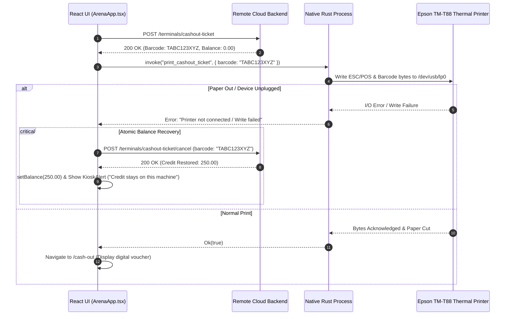

# Betwise Terminal — API Specification & Backend Integrations

**Document Version:** 1.0.0  
**Scope:** REST API Contract, Hardware Authentication, Request/Response Envelopes, and Error Handover  
**Repository:** `Kiosk-tauri` (`betwise-terminal`)  
**Backend Host Origin:** `https://staging.iccpanel.com/api` (or `http://127.0.0.1:8000/api`)

---

## 1. Architectural Overview & Endpoint Namespace

The desktop kiosk terminal connects to the cloud backend (`iccpanel`) using standard JSON over HTTPS.

### 1.1 URL Structure & Namespaces
The client interacts with the backend under two complementary API routes:
1. **Primary Active Implementation (`src/api/client.ts`):**  
   `{API_BASE_URL}/v1/{portal_slug}/shop/terminals/*`
2. **Companion Specification ([`docs/Kiosk-Tauri-API.docx`](file:///home/sys-0743/My_projects_Murali/newfolder/Kiosk-tauri/docs/Kiosk-Tauri-API.docx)):**  
   `{API_BASE_URL}/v1/{portal_slug}/kiosk/kiosks/*`

Both paths map to the retail terminal engine on the `iccpanel` server. The active implementation in [`src/api/client.ts`](file:///home/sys-0743/My_projects_Murali/newfolder/Kiosk-tauri/src/api/client.ts) uses `/v1/{portal_slug}/shop/terminals/*`.

```text
API Origin:           https://staging.iccpanel.com/api
Active Endpoint Base: https://staging.iccpanel.com/api/v1/{portal_slug}/shop/terminals
Documented Base:      https://staging.iccpanel.com/api/v1/{portal_slug}/kiosk/kiosks
```

### 1.2 Authentication Protocol
The kiosk terminal **does not use user sessions, Laravel Sanctum cookies, or Bearer tokens**. Instead, it uses a **Hardware Tuple Signature**:
- **`machine_id`**: A permanent terminal string identifier assigned by the backend at registration (e.g. `KSK000001` or `DEVCITY-PC-002`).
- **`device_fingerprint`**: A cryptographically stable hardware hash computed natively by the Rust host via `machine-uid` (e.g. `HW-a1b2c3d4e5f6...`).

Every HTTP call (GET query parameters or POST JSON payload) must supply this tuple. If the fingerprint fails to match the database record for that machine ID, the call is rejected with `HARDWARE_MISMATCH`.

---

## 2. Common HTTP Headers & Standard Envelopes

### 2.1 Request Headers
```http
Accept: application/json
Content-Type: application/json  (Required for all POST requests)
```

### 2.2 Standard Success Envelope
```json
{
  "success": true,
  "message": "Optional human-readable confirmation string",
  "data": { ... },
  "pagination": {
    "current_page": 1,
    "last_page": 4,
    "per_page": 50,
    "total": 182
  }
}
```

### 2.3 Standard Validation & Error Envelope (HTTP 422 / 403 / 500)
```json
{
  "success": false,
  "message": "The given data was invalid.",
  "errors": {
    "device_fingerprint": [
      "HARDWARE_MISMATCH"
    ],
    "amount": [
      "The amount must be at least 1."
    ]
  }
}
```

---

## 3. Complete REST Endpoint Specifications

### 3.1 Terminal Registration
Binds this physical cabinet to a betting shop location using a one-time 19-character setup token.

- **Method / Path:** `POST /terminals/register` (or `/kiosks/register`)
- **Invocation Context:** Run once during initial setup in [`RegistrationScreen.tsx`](file:///home/sys-0743/My_projects_Murali/newfolder/Kiosk-tauri/src/screens/RegistrationScreen.tsx#L67).
- **HTTP Status:** `201 Created`

#### Request Body
```json
{
  "registration_token": "ABC1234567890123456",
  "device_fingerprint": "HW-8f92b7c4a1e3",
  "operating_system": "Linux"
}
```

#### Success Response (201 Created)
```json
{
  "success": true,
  "message": "Registration successful",
  "data": {
    "id": 14,
    "machine_id": "KSK000014",
    "hostname": "CABIN-POS-01",
    "terminal_name": "CABIN-POS-01",
    "pc_name": "CABIN-POS-01",
    "site_id": 2,
    "shop_id": 2,
    "site_name": "Central Mall Shop",
    "shop_name": "Central Mall Shop",
    "current_balance": 0.00,
    "loaded_amount": 0.00,
    "status": "AVAILABLE",
    "is_hardware_bound": true,
    "portal_slug": "betwise"
  }
}
```

---

### 3.2 Fetch Session & Balance
Retrieves current machine balance, shop association, and active player session.

- **Method / Path:** `GET /terminals/session` (or `/kiosks/session`)
- **Invocation Context:** Invoked on boot and periodically polled by [`ArenaApp.tsx`](file:///home/sys-0743/My_projects_Murali/newfolder/Kiosk-tauri/src/screens/ArenaApp.tsx#L154).
- **Query Parameters:**
  - `machine_id` (string, required)
  - `device_fingerprint` (string, required)

#### Success Response (200 OK)
```json
{
  "success": true,
  "data": {
    "id": 14,
    "player_id": 204,
    "machine_id": "KSK000014",
    "hostname": "CABIN-POS-01",
    "pc_name": "CABIN-POS-01",
    "site_id": 2,
    "shop_id": 2,
    "site_name": "Central Mall Shop",
    "shop_name": "Central Mall Shop",
    "status": "PLAYING",
    "current_balance": 150.00,
    "loaded_amount": 150.00,
    "available_coins": 50000.00,
    "portal_slug": "betwise"
  }
}
```
*Note:* If `available_coins` is returned, the frontend invokes `setShopAvailableCoins()` in Rust to protect the bill validator.

---

### 3.3 Heartbeat
Informs the server that the kiosk terminal is online, active, and functioning.

- **Method / Path:** `POST /terminals/heartbeat` (or `/kiosks/heartbeat`)
- **Invocation Context:** Dispatched every 60 seconds (`HEARTBEAT_MS = 60000`) by [`ArenaApp.tsx`](file:///home/sys-0743/My_projects_Murali/newfolder/Kiosk-tauri/src/screens/ArenaApp.tsx#L216).
- **HTTP Status:** `200 OK`

#### Request Body
```json
{
  "machine_id": "KSK000014",
  "device_fingerprint": "HW-8f92b7c4a1e3",
  "status": "ONLINE"
}
```

#### Success Response (200 OK)
```json
{
  "success": true,
  "data": {
    "machine_id": "KSK000014",
    "status": "ONLINE",
    "portal_slug": "betwise",
    "available_coins": 50000.00
  }
}
```

---

### 3.4 Game Catalog
Retrieves the list of active games configured for this retail shop.

- **Method / Path:** `GET /terminals/games` (or `/kiosks/games`)
- **Query Parameters:**
  - `provider` (string, optional: e.g. `Spribe`)
  - `page` (number, default: `1`)
  - `limit` (number, default: `50`)

#### Success Response (200 OK)
```json
{
  "success": true,
  "data": [
    {
      "id": "aviator",
      "name": "Aviator",
      "category": "Crash & Instant",
      "description": "Spribe Aviator — live crash game.",
      "payout_label": "Live",
      "choices": [],
      "kind": "provider",
      "provider": "Spribe",
      "image": "/assets/games/SPRIBE/AVIATOR.png"
    },
    {
      "id": "lucky_wheel",
      "name": "Lucky Wheel",
      "category": "Wheel",
      "description": "Pick a segment A–E on the wheel.",
      "payout_label": "4× stake",
      "choices": ["A", "B", "C", "D", "E"],
      "kind": "local"
    }
  ],
  "pagination": {
    "current_page": 1,
    "last_page": 1,
    "per_page": 50,
    "total": 2
  }
}
```

---

### 3.5 Game Providers
Fetches available game studios. Falls back to deriving providers dynamically from the game catalog if the endpoint returns HTTP 404.

- **Method / Path:** `GET /terminals/providers`
- **Query Parameters:** `page=1&limit=100`

#### Success Response (200 OK)
```json
{
  "success": true,
  "data": [
    {
      "id": 1,
      "provider": "Spribe",
      "game_count": 14,
      "images": {
        "logo": "/assets/providers/spribe.png"
      }
    }
  ]
}
```

---

### 3.6 Launch Provider Game
Generates an authenticated single-sign-on (SSO) session URL to embed a certified provider game (e.g. Aviator) inside an iframe.

- **Method / Path:** `POST /terminals/launch-game` (or `/kiosks/launch-game`)
- **HTTP Status:** `200 OK`

#### Request Body
```json
{
  "machine_id": "KSK000014",
  "device_fingerprint": "HW-8f92b7c4a1e3",
  "game": "aviator",
  "return_url": "https://staging.iccpanel.com/terminal-return"
}
```

#### Success Response (200 OK)
```json
{
  "success": true,
  "message": "Game launched",
  "data": {
    "game_url": "https://game.spribe.io/launcher?token=eyJhbGciOi...",
    "game_name": "Aviator",
    "provider": "Spribe",
    "game_id": "aviator",
    "player_id": 204
  }
}
```

---

### 3.7 Place Local Bet
Submits a wager for local animated games (Roulette, Coin Flip, Dice, Cards, Goal Kick).

- **Method / Path:** `POST /terminals/place-bet` (or `/kiosks/place-bet`)
- **HTTP Status:** `200 OK`

#### Request Body
```json
{
  "machine_id": "KSK000014",
  "device_fingerprint": "HW-8f92b7c4a1e3",
  "game": "roulette",
  "choice": "red",
  "stake": 50
}
```

#### Success Response (200 OK)
```json
{
  "success": true,
  "data": {
    "game": "roulette",
    "game_name": "Roulette",
    "choice": "red",
    "result": "red 14",
    "won": true,
    "stake": 50.00,
    "payout": 100.00,
    "multiplier": 2.0,
    "current_balance": 200.00,
    "message": "Congratulations! You won N$ 100.00",
    "round_id": "R982341",
    "transaction_id": 4821
  }
}
```

---

### 3.8 Bill-In (Cash Insertion)
Credits the kiosk balance after the GBA ST2 bill validator successfully stacks a genuine banknote.

- **Method / Path:** `POST /terminals/bill-in` (or `/kiosks/bill-in`)
- **HTTP Status:** `200 OK`

#### Request Body
```json
{
  "machine_id": "KSK000014",
  "device_fingerprint": "HW-8f92b7c4a1e3",
  "amount": 50
}
```

#### Success Response (200 OK)
```json
{
  "success": true,
  "message": "Cash-in credited",
  "data": {
    "machine_id": "KSK000014",
    "amount": 50.00,
    "current_balance": 150.00,
    "status": "PLAYING",
    "available_coins": 49950.00
  }
}
```

---

### 3.9 Ticket-In (Barcode Voucher Redemption)
Credits the terminal when a player scans an optical barcode voucher printed from this or any other kiosk in the same betting shop portal.

- **Method / Path:** `POST /terminals/ticket-in` (or `/kiosks/ticket-in`)
- **HTTP Status:** `200 OK`

#### Request Body
```json
{
  "machine_id": "KSK000014",
  "device_fingerprint": "HW-8f92b7c4a1e3",
  "barcode": "TABC123XYZ"
}
```

#### Success Response (200 OK)
```json
{
  "success": true,
  "message": "Ticket credited to this kiosk.",
  "data": {
    "barcode": "TABC123XYZ",
    "amount": 100.00,
    "current_balance": 250.00,
    "status": "PLAYING",
    "message": "Ticket credited to this kiosk."
  }
}
```

---

### 3.10 Cash-Out Ticket Issuance
Converts the player's remaining credit into a printable barcode voucher. **The server immediately zeroes the machine balance.**

- **Method / Path:** `POST /terminals/cashout-ticket` (or `/kiosks/cashout-ticket`)
- **HTTP Status:** `200 OK`

#### Request Body
```json
{
  "machine_id": "KSK000014",
  "device_fingerprint": "HW-8f92b7c4a1e3"
}
```

#### Success Response (200 OK)
```json
{
  "success": true,
  "message": "Cash-out ticket ready to print",
  "data": {
    "ticket_id": 77,
    "barcode": "TABC123XYZ",
    "amount": 250.00,
    "issued_at": "2026-10-15T02:00:00+00:00",
    "print_lines": [
      "BETWISE KIOSK",
      "Terminal : CABIN-POS-01",
      "Amount   : N$ 250.00",
      "Ticket   : TABC123XYZ"
    ],
    "current_balance": 0.00
  }
}
```

---

### 3.11 Cancel Cash-Out Ticket (Atomic Rollback on Printer Failure)
If the Epson thermal printer fails to print the issued ticket (paper out, jammed, or disconnected), this endpoint **voids the generated barcode and restores the exact credit amount back to the terminal screen**.

- **Method / Path:** `POST /terminals/cashout-ticket/cancel` (or `/kiosks/cashout-ticket/cancel`)
- **HTTP Status:** `200 OK`

#### Request Body
```json
{
  "machine_id": "KSK000014",
  "device_fingerprint": "HW-8f92b7c4a1e3",
  "barcode": "TABC123XYZ"
}
```

#### Success Response (200 OK)
```json
{
  "success": true,
  "message": "Print failed. Credit restored to this kiosk.",
  "data": {
    "barcode": "TABC123XYZ",
    "amount": 250.00,
    "current_balance": 250.00,
    "status": "PLAYING",
    "message": "Print failed. Credit restored to this kiosk."
  }
}
```



---

### 3.12 Credit Adjust (Local Arena Games)
Applies balance changes for local interactive games such as Lucky Wheel (negative delta for bets, positive delta for winnings).

- **Method / Path:** `POST /terminals/credit-adjust` (or `/kiosks/credit-adjust`)
- **HTTP Status:** `200 OK`

#### Request Body
```json
{
  "machine_id": "KSK000014",
  "device_fingerprint": "HW-8f92b7c4a1e3",
  "delta": -10.00,
  "remarks": "Game stake"
}
```

#### Success Response (200 OK)
```json
{
  "success": true,
  "message": "Balance updated",
  "data": {
    "current_balance": 240.00,
    "delta": -10.00,
    "status": "PLAYING"
  }
}
```

---

## 4. Error Codes & Client Handover Matrix

| HTTP Status | Server Code / Message | Client Handling Logic | UI Representation |
| :--- | :--- | :--- | :--- |
| **403 / 422** | `HARDWARE_MISMATCH` / `HARDWARE_UNBOUND` | Detected via `isHardwareUnauthorized(err)`. Clears machine session and permanently blocks execution. | Displays [`UnauthorizedScreen`](file:///home/sys-0743/My_projects_Murali/newfolder/Kiosk-tauri/src/screens/UnauthorizedScreen.tsx) (`"PC Not Authorized"`). |
| **422** | `Shop balance too low` | Insufficient portal float to accept banknote or credit ticket. | Displays `KioskAlert` (`"Shop balance low"`). |
| **422** | `Ticket not found / already used` | Barcode invalid, redeemed, or voided. | Displays `KioskAlert` (`"Ticket Void / Invalid"`). |
| **422** | `Insufficient credit` / `Below zero` | Wager exceeds current machine balance. | Triggers [`ZeroBalanceModal`](file:///home/sys-0743/My_projects_Murali/newfolder/Kiosk-tauri/src/components/ZeroBalanceModal.tsx). |
| **500 / Network** | `Failed to fetch` / `NetworkError` | Network offline or API host down. | Displays persistent warning banner; retains credit; auto-retries on next tick. |
| **Printer Jam** | *Native I/O Failure* | Calls `cancelCashOutTicket()` to void barcode and restore screen balance. | Displays `KioskAlert` (`"Cash-out cancelled - Credit stays on this machine"`). |
