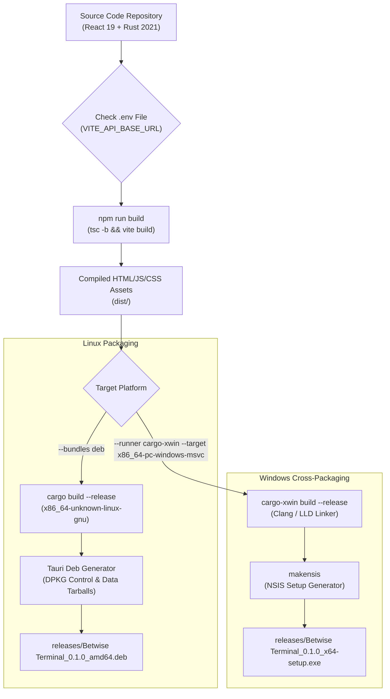

# Betwise Terminal — Build, Packaging & Deployment Guide

**Document Version:** 1.0.0  
**Scope:** Build Pipeline, Cross-Compilation, Linux Debian `.deb`, Windows NSIS Installer, and Cabinet Installation  
**Repository:** `Kiosk-tauri` (`betwise-terminal`)

---

## 1. Toolchain & Build Prerequisites

To compile the native desktop binaries from source, the development or build host requires the following toolchains:

### 1.1 Node.js & Frontend Toolchain
- **Node.js:** v18.x, v20.x, or v22.x LTS
- **Package Manager:** `npm` (v9+)
- **TypeScript:** `~6.0.2`
- **Vite:** `^8.1.1`

### 1.2 Rust Toolchain
- **Rustc:** `1.77.2+` (2021 Edition)
- **Cargo:** Included with Rustup
- **Tauri CLI:** `@tauri-apps/cli` v2.11.4

### 1.3 Linux Ubuntu/Debian Host Dependencies
```bash
sudo apt-get update
sudo apt-get install -y \
  libwebkit2gtk-4.1-dev \
  libgtk-3-dev \
  libayatana-appindicator3-dev \
  librsvg2-dev \
  libssl-dev \
  build-essential \
  curl \
  wget \
  file
```

### 1.4 Windows Cross-Compilation Dependencies (from Ubuntu)
Building Windows `.exe` setup installers directly from an Ubuntu host requires `cargo-xwin` and NSIS:
```bash
sudo apt-get install -y nsis clang lld llvm
rustup target add x86_64-pc-windows-msvc
cargo install cargo-xwin --locked
```

---

## 2. Environment Variables & CSP Configuration

Before building production bundles, ensure the active `.env` file points to the target server:

```ini
# iccpanel API root (include /api, do NOT include portal slug)
VITE_API_BASE_URL=https://staging.iccpanel.com/api

# Default portal slug for setup screen
VITE_PORTAL_SLUG=betwise

# Pusher Cloud configuration (matching backend .env)
VITE_PUSHER_APP_KEY=aada91de6d6a0d8cbd33
VITE_PUSHER_APP_CLUSTER=ap2

# MUST BE FALSE OR EMPTY IN PRODUCTION CABINET BUILDS
VITE_HW_SIMULATOR=false
```

> [!CRITICAL]
> **Tauri Content Security Policy (CSP):**  
> If changing `VITE_API_BASE_URL` to a new domain or production server, ensure that the domain is whitelisted in [`src-tauri/tauri.conf.json`](file:///home/sys-0743/My_projects_Murali/newfolder/Kiosk-tauri/src-tauri/tauri.conf.json#L32) under `app.security.csp` in the `connect-src`, `img-src`, and `default-src` directives. Otherwise, WebKitGTK will reject all API requests at the network layer.

---

## 3. Build & Packaging Commands

### 3.1 Development Mode
Runs Vite dev server on port `5175` with hot module reloading and connects the native Tauri desktop shell:
```bash
npm run tauri:dev
```
*Note:* The Vite config injects a custom `tauri-dev-logger` middleware that relays all webview `console.log`, `console.error`, and uncaught promise rejections directly to the terminal standard output.

### 3.2 Linux `.deb` Installer Build
Compiles the release React bundle and builds an Ubuntu/Debian `.deb` package:
```bash
npm run tauri:build:deb
# Alternatively: bash scripts/build-linux-deb.sh
```
- **Generated Artifact:**  
  `releases/Betwise Terminal_0.1.0_amd64.deb`  
  *(also mirrored at `src-tauri/target/release/bundle/deb/`)*

### 3.3 Windows NSIS Installer Cross-Compilation
Compiles an x64 Windows installer from an Ubuntu workstation:
```bash
npm run tauri:build:windows
# Alternatively: bash scripts/build-windows-from-ubuntu.sh
```
- **Generated Artifact:**  
  `releases/Betwise Terminal_0.1.0_x64-setup.exe`  
  *(and standalone executable `releases/betwise-terminal.exe`)*

---

## 4. Linux Cabinet Deployment Guide

### 4.1 Package Installation
Transfer the generated `.deb` package to the target kiosk cabinet:
```bash
sudo dpkg -i "Betwise Terminal_0.1.0_amd64.deb"
sudo apt-get install -f # Fix any missing runtime dependencies
```

### 4.2 Hardware Permissions (Mandatory)
Ensure that the standard kiosk operating system user has direct permission to read and write to raw hardware device nodes:
```bash
sudo usermod -aG lp,dialout $USER
```
- `dialout`: Permits reading `/dev/ttyUSB0` (Bill Acceptor).
- `lp`: Permits writing to `/dev/usb/lp0` (Thermal Printer).
*Log out and log back in, or reboot the cabinet PC.*

### 4.3 Configure Autostart (Kiosk Mode)
To launch the application automatically upon machine boot:
Create an autostart entry under `~/.config/autostart/betwise-terminal.desktop`:
```ini
[Desktop Entry]
Type=Application
Name=Betwise Terminal
Exec=/usr/bin/betwise-terminal
Hidden=false
NoDisplay=false
X-GNOME-Autostart-enabled=true
```

### 4.4 Initial Provisioning & Verification
1. Boot the kiosk cabinet. The application opens in fullscreen mode.
2. In the `RegistrationScreen`, enter the shop's `Portal Slug` (e.g. `betwise`) and the 19-character `Registration Token` provided by the shop manager.
3. Tap **"REGISTER KIOSK ›"**. Upon verification, tap **"ENTER BETTING ARENA ›"**.
4. Press **`Ctrl+Shift+D`** and enter `admin123` to open the hardware test panel.
5. Tap **"Test receipt print"** to verify the Epson thermal printer.
6. Insert a test banknote into the GBA ST2 bill validator to verify that pulses are recorded.

---

## 5. Windows Cabinet Deployment Guide

### 5.1 Installation
1. Copy `Betwise Terminal_0.1.0_x64-setup.exe` to the Windows POS terminal.
2. Run the installer and complete the setup wizard.

### 5.2 Hardware Configuration (`config.json`)
The application creates or reads `config.json` in the application root directory:
1. Open **Device Manager** -> **Ports (COM & LPT)**.
2. Identify the COM port assigned to the USB-to-Serial adapter for the GBA ST2 validator (e.g. `COM3`).
3. Set `BillAcceptor_Port` in `config.json`:
   ```json
   {
     "BillAcceptor_Port": "COM3",
     "Printer_Device": "\\\\.\\USB001"
   }
   ```
4. If the printer is connected over raw USB, prefer `\\.\USB001` or install Windows "Generic / Text Only" driver.
5. Restart the Betwise Terminal application.

---

## 6. Build & Packaging Flow Diagram


