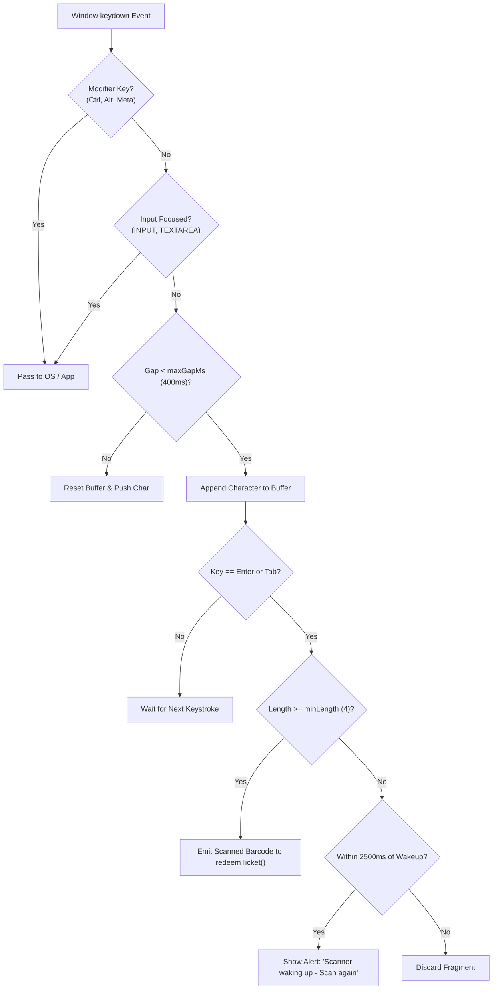

# Betwise Terminal — Hardware Communication & Physical Security

**Document Version:** 1.0.0  
**Scope:** Serial ccTalk Drivers, Direct ESC/POS Printer I/O, HID Barcode Wedging, and Physical Kiosk Security  
**Repository:** `Kiosk-tauri` (`betwise-terminal`)

---

## 1. Hardware Subsystem Matrix

The Betwise Terminal kiosk integrates three essential peripheral devices directly within the physical cabinet:

| Peripheral Device | Target Model | Protocol / Interface | Physical Interface | Baud Rate / Mode | Driver Module |
| :--- | :--- | :--- | :--- | :--- | :--- |
| **Bill Acceptor** | AstroSys GBA ST2 | ccTalk Plain (Slave 40) | USB-to-Serial (`/dev/ttyUSB0` or `COM3`) | 9600 baud, 8N1 | [`bill_acceptor.rs`](file:///home/sys-0743/My_projects_Murali/newfolder/Kiosk-tauri/src-tauri/src/hardware/bill_acceptor.rs) |
| **Receipt Printer** | Epson TM-T88V / TM-T88IV | Raw ESC/POS | USB Direct (`/dev/usb/lp0` or `\\.\USB001`) | Direct Device Write | [`printer.rs`](file:///home/sys-0743/My_projects_Murali/newfolder/Kiosk-tauri/src-tauri/src/hardware/printer.rs) |
| **Barcode Scanner**| Zebex Z-5160 / Ultrascan | HID Keyboard Wedge | USB HID (Keyboard Class) | Keystroke Burst | [`barcodeBridge.ts`](file:///home/sys-0743/My_projects_Murali/newfolder/Kiosk-tauri/src/hardware/barcodeBridge.ts) |

---

## 2. AstroSys GBA ST2 Bill Acceptor Driver

The bill validator operates over a dedicated background worker thread implemented in Rust ([`src-tauri/src/hardware/bill_acceptor.rs`](file:///home/sys-0743/My_projects_Murali/newfolder/Kiosk-tauri/src-tauri/src/hardware/bill_acceptor.rs)).

### 2.1 Communication Protocol Specifications
- **Standard:** ccTalk Plain Protocol
- **Slave Address:** `40` (`BV_ADDR = 40`)
- **Host Address:** `1` (`HOST_ADDR = 1`)
- **Port Settings:** 9600 Baud, 8 Data Bits, No Parity, 1 Stop Bit (8N1).
- **Polling Interval:** 200 milliseconds.
- **Checksum Calculation:** Supports both classic 8-bit two's complement checksum (`checksum8`) and CRC16-CCITT (`crc16_ccitt`), automatically negotiated during initialization.

### 2.2 Channel Currency Mapping
Default banknote channels for the Namibian Dollar (`NAD` / `N$`):
```rust
fn default_channels() -> HashMap<u8, f64> {
  HashMap::from([
    (1, 10.0),   // Channel 1: NAD 10 Note
    (2, 10.0),   // Channel 2: NAD 10 Note (Alt Issue)
    (3, 20.0),   // Channel 3: NAD 20 Note
    (4, 20.0),   // Channel 4: NAD 20 Note (Alt Issue)
    (5, 50.0),   // Channel 5: NAD 50 Note
    (6, 50.0),   // Channel 6: NAD 50 Note (Alt Issue)
    (7, 100.0),  // Channel 7: NAD 100 Note
  ])
}
```

### 2.3 Shop Balance Guard (`SHOP_AVAILABLE_CENTS`)
To protect betting shop owners from taking cash when shop payout reserves are low:
1. Every server heartbeat and session sync returns `available_coins`.
2. Rust stores this value in `static SHOP_AVAILABLE_CENTS: AtomicU64`.
3. When a customer inserts a banknote into the feeder, the driver compares the note value against `SHOP_AVAILABLE_CENTS`:
   - If `note_value > shop_available`: The driver sends command `route_bill(0)` (reject/return note), and emits:
     ```json
     { "reason": "shop_balance_too_low" }
     ```
   - If acceptable: The driver commands `route_bill(1)` (stack note) and emits `note-accepted`.

### 2.4 Event Buffer & Rejection Codes
The driver reads the 229 buffer (`Read Buffered Credit or Error Codes`). Rejection codes are mapped directly to user-facing explanations:

| Rejection Code | Physical Condition | Kiosk Alert Displayed |
| :--- | :--- | :--- |
| `shop_balance_too_low` | Shop float is lower than note value | `"Shop balance too low"` |
| `code_2` | Note unrecognized / dirty / counterfeit | `"This note was not recognised. Use a clean NAD 10 / 20 / 50 / 100 note."` |
| `code_3` | Feeder jam / misaligned entry | `"Note was rejected in the feeder. Insert flat, follow the arrow, and release."` |
| `code_4` / `code_5` | Inhibited bill channel | `"This note type is not accepted on this machine."` |

---

## 3. Epson TM-T88 Thermal Receipt Printer Driver

Ticket printing is implemented in [`src-tauri/src/hardware/printer.rs`](file:///home/sys-0743/My_projects_Murali/newfolder/Kiosk-tauri/src-tauri/src/hardware/printer.rs). It communicates directly with the printer device node via raw binary I/O, bypassing CUPS or print spoolers.

### 3.1 Device Paths & Discovery
- **Linux:** `/dev/usb/lp0` (falls back to `/dev/usb/lp1`, `/dev/usb/lp2`).
- **Windows:** `\\.\USB001` (falls back to `\\.\USB002`, `\\.\LPT1`).

### 3.2 ESC/POS Command Byte Sequences
The driver assembles standard ESC/POS command sequences:

```rust
// 1. Initialize Printer
payload.extend_from_slice(&[0x1b, 0x40]);

// 2. Center Alignment
payload.extend_from_slice(&[0x1b, 0x61, 0x01]);

// 3. Emphasized Title (Bold On)
payload.extend_from_slice(&[0x1b, 0x45, 0x01]);
payload.extend_from_slice(b"CREDIT TICKET\n");
payload.extend_from_slice(&[0x1b, 0x45, 0x00]);

// 4. Ticket Metadata Box (Left Aligned)
payload.extend_from_slice(&[0x1b, 0x61, 0x00]);
payload.extend_from_slice(ticket_body_bytes);

// 5. Code 128 Barcode Configuration
payload.extend_from_slice(&[0x1b, 0x61, 0x01]);       // Center
payload.extend_from_slice(&[0x1d, 0x68, 80]);         // Barcode Height: 80 dots
payload.extend_from_slice(&[0x1d, 0x77, 2]);          // Barcode Width: 2 dots
payload.extend_from_slice(&[0x1d, 0x48, 0x02]);       // HRI Characters: Print Below
payload.extend_from_slice(&[0x1d, 0x6b, 73, len]);    // GS k (Code 128)
payload.extend_from_slice(&code128_data);

// 6. Paper Feed and Partial Cut
payload.extend_from_slice(b"\n\n\n\n");
payload.extend_from_slice(&[0x1d, 0x56, 0x42, 0x00]); // GS V B 0 (Cut Paper)
```

### 3.3 Printed Receipt Layout
```text
================================
CREDIT TICKET
================================
Terminal : KSK-001
Amount   : N$ 250.00 NAD
Ticket   : TABC123XYZ
Date     : 2026-10-15 02:00:00
================================
 Scan this ticket on any kiosk
 to continue with this balance.
================================

      |||| |||| |||| ||||
          TABC123XYZ
```

---

## 4. Zebex HID Barcode Scanner Wedge

Barcode scanners function as USB Human Interface Devices (HID), streaming characters as simulated keyboard events. Because kiosks receive arbitrary user touches, [`src/hardware/barcodeBridge.ts`](file:///home/sys-0743/My_projects_Murali/newfolder/Kiosk-tauri/src/hardware/barcodeBridge.ts) provides a timing-sensitive wedge parser:



- **Timing Thresholds:**
  - `minLength`: 4 characters.
  - `maxGapMs`: 400ms between successive keystrokes during active bursts.
  - `idleGapMs`: 600ms allowance when waking from an idle state.
  - `idleAfterMs`: 3000ms idle threshold before entering wake mode.
  - Duplicate suppression: Rejects identical scans within 1200ms.

---

## 5. Physical Kiosk Security & Keyboard Policy

### 5.1 Zero-Balance DOM Keyboard Lockout
Public kiosks must prevent players from opening devtools, zooming, or manipulating DOM elements when no credit is active.

Inside [`ArenaApp.tsx`](file:///home/sys-0743/My_projects_Murali/newfolder/Kiosk-tauri/src/screens/ArenaApp.tsx#L317-L364):
```typescript
function handleKioskKeyboardPolicy(e: KeyboardEvent) {
  const currentBal = useMachine.getState().balance
  if (currentBal > 0) return // Keyboard unlocked for game controls

  if (e.ctrlKey && e.shiftKey) return // Allow staff shortcuts

  const target = e.target as HTMLElement | null
  if (target && (target.tagName === 'INPUT' || target.closest('.winbet-modal-card'))) {
    return // Allow typing in password modals
  }

  if (document.body.classList.contains('is-game-active')) return

  // Intercept and prevent default browser actions
  if (
    e.key === 'Tab' || e.key === ' ' || e.key === 'Backspace' || e.key === 'Escape' ||
    e.key.startsWith('Arrow') || e.key.startsWith('F') ||
    e.key === 'Home' || e.key === 'End' || e.key === 'PageUp' || e.key === 'PageDown'
  ) {
    e.preventDefault()
  }
}
```

### 5.2 Staff Privileged Gate Shortcuts

| Shortcut | Gate Component | Password Required | Permitted Balance | Behavior |
| :--- | :--- | :--- | :--- | :--- |
| **`Ctrl+Shift+K`** | [`StaffExitGate`](file:///home/sys-0743/My_projects_Murali/newfolder/Kiosk-tauri/src/components/StaffExitGate.tsx) | `AdminPassword` in `config.json` | Any | Calls `exit_kiosk_mode` in Rust; exits fullscreen; resizes window to 1280x800 for OS maintenance. |
| **`Ctrl+Shift+D`** | [`HardwareTestGate`](file:///home/sys-0743/My_projects_Murali/newfolder/Kiosk-tauri/src/components/HardwareTestGate.tsx) | `AdminPassword` in `config.json` | Any | Opens peripheral diagnostic dashboard; sets `installTestActive = true` (pauses live crediting); tests print, scan, and bill validator. |
| **`Ctrl+Shift+R`** | Re-register Trigger | None | **`balance <= 0` Only** | Clears stored machine credentials and opens `RegistrationScreen`. Blocked with an alert if `balance > 0`. |
| **`Ctrl+Shift+H`** | [`HardwareLabPanel`](file:///home/sys-0743/My_projects_Murali/newfolder/Kiosk-tauri/src/components/HardwareLabPanel.tsx) | None | Any | Toggles hardware simulator drawer (only available if `VITE_HW_SIMULATOR=true`). |

---

## 6. Linux System Permissions & Diagnostics

On Linux POS cabinets, physical access to serial and USB printer nodes requires specific group memberships.

### 6.1 Required User Groups
```bash
sudo usermod -aG lp,dialout $USER
# Log out and log back in, or reboot the kiosk PC
```
- **`dialout`**: Grants read/write permissions to `/dev/ttyUSB*` (AstroSys GBA ST2 bill acceptor).
- **`lp`**: Grants write permissions to `/dev/usb/lp*` (Epson TM-T88 receipt printer).

### 6.2 Diagnostic Checklist (`src-tauri/src/hardware/diagnose.rs`)
Running `Ctrl+Shift+D` executes the native diagnostic routine, verifying:
1. `groups`: Checks if `$USER` belongs to `lp` and `dialout`.
2. `printer_device`: Verifies existence of `/dev/usb/lp0` (or Windows `\\.\USB001`).
3. `printer_write`: Attempts a non-destructive write handle open on the printer node.
4. `bill_port`: Verifies serial node existence and validates 9600 baud open.
