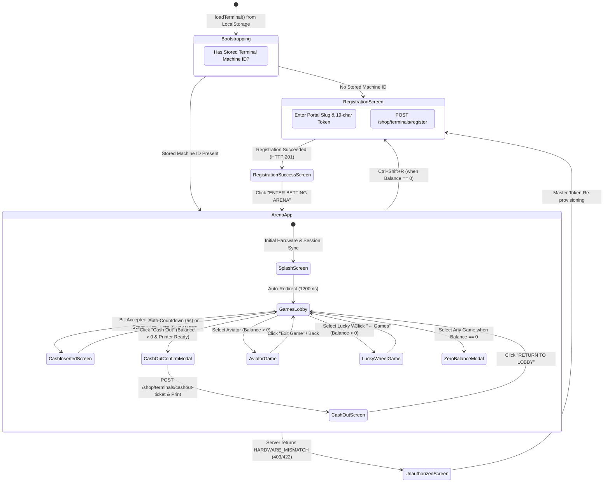
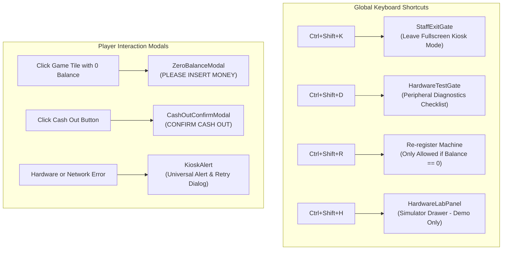

# Betwise Terminal — Page Flows, Routes & Navigation Lifecycle

**Document Version:** 1.0.0  
**Scope:** Navigation Map, Screen Hierarchy, State Transitions, and Modal Dialogs  
**Repository:** `Kiosk-tauri` (`betwise-terminal`)

---

## 1. Top-Level State Machine & Screen Progression

Application navigation operates on two distinct layers:
1. **The Root Conditional State Machine ([`App.tsx`](file:///home/sys-0743/My_projects_Murali/newfolder/Kiosk-tauri/src/App.tsx)):** Governs machine provisioning, registration tokens, hardware mismatch locking, and transitions into the betting arena.
2. **The Client Router ([`ArenaApp.tsx`](file:///home/sys-0743/My_projects_Murali/newfolder/Kiosk-tauri/src/screens/ArenaApp.tsx)):** A React Router `HashRouter` that drives user navigation between the lobby, cash-in displays, cash-out ticket summaries, and individual games.

---

## 2. Master Route Table

The internal routing of the betting arena is encapsulated inside [`ArenaApp.tsx`](file:///home/sys-0743/My_projects_Murali/newfolder/Kiosk-tauri/src/screens/ArenaApp.tsx#L763-L788) using `HashRouter`:

| Hash Route Path | Component | Guard / Pre-condition | Wrapped In Shell | Visible Shell Elements | Description |
| :--- | :--- | :--- | :--- | :--- | :--- |
| `#/` | [`SplashScreen`](file:///home/sys-0743/My_projects_Murali/newfolder/Kiosk-tauri/src/screens/SplashScreen.tsx) | None | No Shell | None (Fullscreen splash) | Bootloader animation. Waits 1200ms and redirects to `#/home`. |
| `#/home` | [`HomeScreen`](file:///home/sys-0743/My_projects_Murali/newfolder/Kiosk-tauri/src/screens/HomeScreen.tsx) | None (Default Lobby) | [`ArenaShell`](file:///home/sys-0743/My_projects_Murali/newfolder/Kiosk-tauri/src/components/ArenaShell.tsx) | Header Bar, Balance Chip, Cash-Out Button, Sound/Staff Actions | Main betting portal lobby. Re-exports `GamesLobby`. |
| `#/play` | [`GamesLobby`](file:///home/sys-0743/My_projects_Murali/newfolder/Kiosk-tauri/src/screens/GamesLobby.tsx) | None | [`ArenaShell`](file:///home/sys-0743/My_projects_Murali/newfolder/Kiosk-tauri/src/components/ArenaShell.tsx) | Header Bar, Balance Chip, Cash-Out Button, Sound/Staff Actions | Main catalog browsing grid, featured Spribe slider, provider tabs, and search HUD. |
| `#/play/aviator`| [`AviatorGame`](file:///home/sys-0743/My_projects_Murali/newfolder/Kiosk-tauri/src/screens/games/AviatorGame.tsx) | [`RequireCredit`](file:///home/sys-0743/My_projects_Murali/newfolder/Kiosk-tauri/src/components/RequireCredit.tsx) (`balance > 0`) | [`ArenaShell`](file:///home/sys-0743/My_projects_Murali/newfolder/Kiosk-tauri/src/components/ArenaShell.tsx) | `creditPanel: false, hideHeader: true` | Dedicated Spribe Aviator crash game iframe container with overlay exit controls. |
| `#/play/wheel` | [`LuckyWheelGame`](file:///home/sys-0743/My_projects_Murali/newfolder/Kiosk-tauri/src/screens/games/LuckyWheelGame.tsx) | [`RequireCredit`](file:///home/sys-0743/My_projects_Murali/newfolder/Kiosk-tauri/src/components/RequireCredit.tsx) (`balance > 0`) | [`ArenaShell`](file:///home/sys-0743/My_projects_Murali/newfolder/Kiosk-tauri/src/components/ArenaShell.tsx) | `creditPanel: false, hideHeader: true` | Dedicated 8-segment local multiplier wheel game with quick stake selectors. |
| `#/cash-in` | [`CashInsertedScreen`](file:///home/sys-0743/My_projects_Murali/newfolder/Kiosk-tauri/src/screens/CashInsertedScreen.tsx) | Credit successfully loaded | [`ArenaShell`](file:///home/sys-0743/My_projects_Murali/newfolder/Kiosk-tauri/src/components/ArenaShell.tsx) | `creditPanel: false` | Hero modal showing loaded cash or voucher amount, with a 5-second automatic forward countdown to `#/play`. |
| `#/cash-out` | [`CashOutScreen`](file:///home/sys-0743/My_projects_Murali/newfolder/Kiosk-tauri/src/screens/CashOutScreen.tsx) | Cash-out ticket issued | [`ArenaShell`](file:///home/sys-0743/My_projects_Murali/newfolder/Kiosk-tauri/src/components/ArenaShell.tsx) | `creditPanel: false` | Digital representation of the printed thermal barcode voucher. Displays total amount and terminal ID. |
| `*` (Catch-all) | Redirect to `#/home` | None | N/A | N/A | Catches invalid URLs and returns players safely to the main lobby. |

---

## 3. Screen Breakdown & UI Lifecycle

### 3.1 Initial Setup: RegistrationScreen
- **Trigger:** Rendered by [`App.tsx`](file:///home/sys-0743/My_projects_Murali/newfolder/Kiosk-tauri/src/App.tsx#L75-L88) when `loadTerminal()` returns `null` or when the re-registration gate is activated (`isReRegistering === true`).
- **Input Fields:**
  - `Portal Slug`: Name of the tenant portal (e.g. `betwise`). Defaults to `VITE_PORTAL_SLUG` or stored slug.
  - `Setup Token`: 19-character alphanumeric registration token (3-letter shop prefix + 16 numeric digits, formatted as `ABC1234567890123456`).
- **Interactive Features:**
  - Includes an integrated full QWERTY virtual touch keyboard for physical cabinets without external hardware keyboards.
  - Includes developer simulation actions (`unbindDevHardware`, `resetToRealHardware`) in development mode.
- **Submission:** Submits `POST /api/v1/{portal_slug}/shop/terminals/register`. On HTTP 201 success, stores machine credentials in `localStorage` under `kiosk-terminal` and transitions to `RegistrationSuccessScreen`.

### 3.2 RegistrationSuccessScreen
- **Visuals:** Displays a large green confirmation badge (`02 Registration Complete`), verified shop name (`site_name`), assigned terminal name (`pc_name`), and instructions for cashier coin provisioning.
- **Action:** Clicking **"ENTER BETTING ARENA ›"** invokes `handleContinueFromSuccess()`, which loads the stored terminal profile and opens `ArenaApp`.

### 3.3 Main Shell: ArenaShell
- **Structure:** Wraps all inner views.
- **Top Bar Header:**
  - **Left:** Brand logo (`BETWISE`), live station status capsule with pulsating green indicator, terminal identifier (`pc_name`), and shop site tag.
  - **Right:**
    - Live Balance Chip: Displays formatted balance (e.g. `N$ 150.00`).
    - Cash Out Button: Active only when `balance > 0` and the Epson printer is connected (`printerReady === true`).
    - Sound Toggle Button: Toggles UI audio mute.
    - Staff Key Button: Triggers virtual `Ctrl+Shift+K` event.
    - Re-register Button: Triggers `Ctrl+Shift+R` setup modal (only permitted when `balance <= 0`).

### 3.4 GamesLobby & BettingLobby
- **Catalog Navigation:**
  - **Category Tabs:** `All Games`, `Spribe` (default), `Providers`, `Slots`, `Crash`, `Live`.
  - **Featured Spribe Slider:** Auto-scrolling horizontal carousel featuring top titles (Aviator, Dice, Goal, Plinko, Mines, Hilo, Keno, Mini Roulette, Hotline, Balloon, Multi Keno 80, Pilot Chicken, Crash Plane, Trader).
  - **Search HUD:** Instant filter input searching titles, categories, and providers.
- **Zero-Balance Lockout:**
  - If `balance <= 0`, game tiles display a translucent locked state.
  - Clicking any game card while balance is zero triggers [`ZeroBalanceModal`](file:///home/sys-0743/My_projects_Murali/newfolder/Kiosk-tauri/src/components/ZeroBalanceModal.tsx) ("Please Insert Money").
- **Game Launch Routing:**
  - When a local interactive game is selected, `GamesLobby` mounts [`GamePlayPanel`](file:///home/sys-0743/My_projects_Murali/newfolder/Kiosk-tauri/src/components/GamePlayPanel.tsx).
  - When a certified provider game is selected, `GamesLobby` mounts [`ProviderGamePanel`](file:///home/sys-0743/My_projects_Murali/newfolder/Kiosk-tauri/src/components/ProviderGamePanel.tsx).

### 3.5 Game Panels (Provider & Local)
- **`ProviderGamePanel.tsx`:**
  - Calls `POST /shop/terminals/launch-game` with `game: game.id`.
  - Renders the remote game URL inside a fullscreen sandboxed iframe.
  - Adds `is-game-active` class to `document.body` to suppress the top navigation bar.
  - Adds an unobtrusive top floating bar showing the live real-time clock, terminal name, current balance, and an **"✕ Exit Game"** button that safely closes the session and re-polls the session balance.
- **`GamePlayPanel.tsx`:**
  - Houses interactive local games (Roulette, Coin Flip, Dice Roll, Red/Black, Goal Kick, Lucky Wheel).
  - Provides quick stake chips (`N$ 10`, `N$ 25`, `N$ 50`, `N$ 100`, `N$ 200`).
  - Calls `POST /shop/terminals/place-bet` on choice click and renders spinning animations for 1400ms before revealing winning or losing outcomes.

### 3.6 CashInsertedScreen
- **Trigger:** Automatically navigated when `note-accepted` is processed by `acceptCash()` or when a ticket barcode is scanned by `redeemTicket()`.
- **Display:** Displays large golden banner with the exact credited amount (`+N$ 50.00`) and the source (`Bill Acceptor` or `Ticket Voucher In`).
- **Timer:** Features a 5-second animated progress bar. When time expires, or when the player taps **"PLAY GAMES ›"**, the app navigates directly to `#/play`.

### 3.7 CashOutScreen
- **Trigger:** Navigated after a successful cash-out ticket generation.
- **Display:** Shows a high-contrast digital replica of the printed voucher ticket containing the payable amount, terminal ID, barcode graphic, and alphabetic barcode string (e.g. `TABC123XYZ`).
- **Notice:** Confirms that the terminal balance has returned to `N$ 0.00` and reminds players to collect the physical paper ticket from the printer tray.

### 3.8 Security Lockdown: UnauthorizedScreen
- **Trigger:** Displayed when the remote backend rejects any API call with `HARDWARE_MISMATCH` or `HARDWARE_UNBOUND`.
- **Purpose:** Prevents unauthorized operation if the kiosk disk image has been copied to unapproved PC hardware. Requires administrative intervention and a new registration token.

---

## 4. Modal Dialogs & Administrative Gates

### 4.1 ZeroBalanceModal ("Please Insert Money")
- **File:** [`src/components/ZeroBalanceModal.tsx`](file:///home/sys-0743/My_projects_Murali/newfolder/Kiosk-tauri/src/components/ZeroBalanceModal.tsx)
- **Role:** Displays a glowing 3D casino visual and prompts the player to insert cash into the bill validator or scan a voucher ticket.
- **Auto-Dismiss:** If a banknote or voucher is inserted while this modal is open, the modal automatically closes upon balance update.

### 4.2 CashOutConfirmModal ("Confirm Cash Out")
- **File:** [`src/components/CashOutConfirmModal.tsx`](file:///home/sys-0743/My_projects_Murali/newfolder/Kiosk-tauri/src/components/CashOutConfirmModal.tsx)
- **Role:** Pre-flight modal asking the player to confirm that they wish to convert their entire active balance into a printed voucher ticket.
- **Actions:**
  - **Confirm & Print Ticket:** Executes `cashOut()`, invoking the backend and triggering the ESC/POS printer.
  - **Cancel:** Dismisses the modal and returns the player to their games.

### 4.3 KioskAlert (Universal Alert & Error Dialog)
- **File:** [`src/components/KioskAlert.tsx`](file:///home/sys-0743/My_projects_Murali/newfolder/Kiosk-tauri/src/components/KioskAlert.tsx)
- **Role:** Single source of truth for user notifications (warnings, errors, hardware notifications).
- **Tone Mapping:**
  - `gold / warn`: Note feeder rejections, active credit reload warnings.
  - `red / error`: Network disconnection, printer offline, ticket invalid/voided.
  - `green / ok`: Successful operational updates.
- **Adaptive Action Button:** Dynamically changes label and behavior based on context (e.g. `"SCAN TICKET AGAIN"`, `"TRY AGAIN"`, `"OK"`).

### 4.4 StaffExitGate (`Ctrl+Shift+K`)
- **File:** [`src/components/StaffExitGate.tsx`](file:///home/sys-0743/My_projects_Murali/newfolder/Kiosk-tauri/src/components/StaffExitGate.tsx)
- **Role:** Protected by `AdminPassword` in `config.json` (default `admin123`).
- **Function:** Calls `exit_kiosk_mode` in Rust, turning off fullscreen, re-enabling window borders, and minimizing to 1280x800 for maintenance.

### 4.5 HardwareTestGate (`Ctrl+Shift+D`)
- **File:** [`src/components/HardwareTestGate.tsx`](file:///home/sys-0743/My_projects_Murali/newfolder/Kiosk-tauri/src/components/HardwareTestGate.tsx)
- **Role:** Password-protected diagnostic suite. Sets `installTestActive = true` to freeze real cash and ticket crediting while testing hardware components.
- **Checks:**
  1. Linux user groups (`lp`, `dialout`).
  2. Printer device node existence and write permissions.
  3. Bill acceptor serial port access.
  4. Real-time test print slip generation.
  5. Live note insertion test (logs banknote pulses without crediting server balance).
  6. Live barcode scan test (displays read characters without redeeming voucher).

### 4.6 HardwareLabPanel (`Ctrl+Shift+H` / `Ctrl+Shift+L`)
- **File:** [`src/components/HardwareLabPanel.tsx`](file:///home/sys-0743/My_projects_Murali/newfolder/Kiosk-tauri/src/components/HardwareLabPanel.tsx)
- **Role:** Development testing drawer enabled only when `VITE_HW_SIMULATOR=true`.
- **Capabilities:** Injects fake banknotes (10, 20, 50, 100, 200), scans arbitrary voucher codes, simulates printer paper jams / cut failures, and downloads digital SVG tickets for visual verification.
