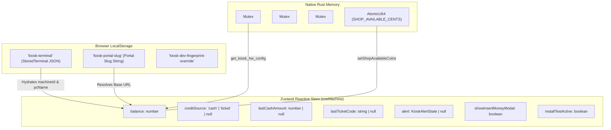

# Betwise Terminal — State Management & Data Contracts

**Document Version:** 1.0.0  
**Scope:** Frontend Reactive Store, LocalStorage Persistence, Native Hardware Mutexes, and TypeScript Interfaces  
**Repository:** `Kiosk-tauri` (`betwise-terminal`)

---

## 1. State Architecture Overview

State in Betwise Terminal is organized across three tiers:
1. **Frontend Reactive State (Zustand):** Powers the user interface, active balance displays, modal states, and temporary transaction data in [`src/services/sessionStore.ts`](file:///home/sys-0743/My_projects_Murali/newfolder/Kiosk-tauri/src/services/sessionStore.ts).
2. **Persistent Cabinet Storage (LocalStorage):** Preserves machine identification, site configuration, and tenant portal slugs across cabinet reboots in [`src/lib/storage.ts`](file:///home/sys-0743/My_projects_Murali/newfolder/Kiosk-tauri/src/lib/storage.ts).
3. **Native Hardware State (Rust Mutexes):** Holds hardware device handles, port paths, and atomic shop coin limits in [`src-tauri/src/hardware/mod.rs`](file:///home/sys-0743/My_projects_Murali/newfolder/Kiosk-tauri/src-tauri/src/hardware/mod.rs).



---

## 2. Zustand Reactive Store (`useMachine`)

Implemented in [`src/services/sessionStore.ts`](file:///home/sys-0743/My_projects_Murali/newfolder/Kiosk-tauri/src/services/sessionStore.ts).

### 2.1 State Definition Table

| State Property | TypeScript Type | Initial Value | Mutator Function | Purpose & Lifecycle |
| :--- | :--- | :--- | :--- | :--- |
| `config` | `KioskConfig \| null` | `null` | `setConfig(c)` | Holds hardware and currency configurations (`CurrencySymbol`, `Terminal_ID`). |
| `machineId` | `string` | `""` | `setMachineId(id)` | Laravel backend identifier used for all hardware REST calls. |
| `balance` | `number` | `0` | `setBalance(b)` | Current playable credits on screen. Automatically clamped to `Math.max(0, val)`. |
| `lastCashAmount` | `number \| null` | `null` | `setLastCash(amt)` | Amount of the most recent banknote or voucher credited; displayed in success screens. |
| `lastTicketCode` | `string \| null` | `null` | `setLastTicket(code)`| Barcode string of the most recent voucher scanned or cashed out. |
| `creditSource` | `'cash' \| 'ticket' \| null`| `null` | `setCreditSource(src)`| Distinguishes between physical banknote insertion and optical voucher redemption. |
| `statusMessage` | `Flash \| null` | `null` | `setStatus(flash)` | Ephemeral toast notification displayed at the top of the screen. |
| `alert` | `KioskAlertState \| null`| `null` | `showAlert(alert)`<br>`clearAlert()` | Centralized blocking modal dialog state (tone, title, message, timeout). |
| `printerWarning` | `string \| null` | `null` | `setPrinterWarning(msg)`| Warning text displayed on cash-out if the printer encounters a non-fatal warning. |
| `installTestActive` | `boolean` | `false` | `setInstallTestActive(act)`| Flag set while `HardwareTestGate` is open; inhibits live cash and ticket crediting. |
| `showInsertMoneyModal`| `boolean` | `false` | `setShowInsertMoneyModal(s)`| Controls visibility of the `ZeroBalanceModal` when a player clicks a game tile. |

---

## 3. Persistent LocalStorage Schema

The terminal stores minimal metadata in browser `localStorage` to survive hardware power cuts and application restarts:

### 3.1 Key Inventory

| Key | Storage Value Schema | Typical Content | Description |
| :--- | :--- | :--- | :--- |
| **`kiosk-terminal`** | `StoredTerminal` (JSON) | `{"machineId":"KSK000001","siteName":"Mall Shop","pcName":"CABIN-01","hostname":"CABIN-01","portalSlug":"betwise"}` | Master terminal binding. Cleared only upon manual staff re-registration (`Ctrl+Shift+R`). |
| **`kiosk-portal-slug`** | `string` | `"betwise"` | Tenant routing slug. Used to build all API URLs (`/v1/{portal_slug}/shop/*`). |
| **`kiosk-device-fingerprint`** | `string` | `"WEB-4a2e8f1b-..."` | Fallback fingerprint generated in web browser development mode when outside Tauri runtime. |
| **`kiosk-dev-fingerprint-override`**| `string` | `"DEV-HW-3F8B1A2C"` | Testing override generated by `unbindDevHardware()` to simulate machine cloning. |

---

## 4. Master TypeScript Contracts & Interfaces

The core data structures governing the terminal are defined across [`src/api/client.ts`](file:///home/sys-0743/My_projects_Murali/newfolder/Kiosk-tauri/src/api/client.ts), [`src/lib/storage.ts`](file:///home/sys-0743/My_projects_Murali/newfolder/Kiosk-tauri/src/lib/storage.ts), and [`src/games/catalog.ts`](file:///home/sys-0743/My_projects_Murali/newfolder/Kiosk-tauri/src/games/catalog.ts):

### 4.1 Terminal Provisioning & Session Models
```typescript
export type StoredTerminal = {
  machineId: string
  siteName: string
  pcName: string
  hostname: string
  portalSlug?: string
}

export type TerminalRegistration = {
  success: boolean
  message: string
  machine_id: string
  hostname: string
  pc_name: string
  site_id: number
  site_name: string
  status: string
  portal_slug?: string
}

export type TerminalSession = {
  id?: number
  player_id?: number | null
  machine_id: string
  hostname: string
  pc_name: string
  site_id: number
  site_name: string
  status: string
  current_balance: number
  loaded_amount: number
  available_coins?: number
  portal_slug?: string
}
```

### 4.2 Financial Transaction Contracts
```typescript
export type BillInResult = {
  machine_id: string
  amount: number
  current_balance: number
  status: string
  available_coins?: number
}

export type TicketInResult = {
  barcode: string
  amount: number
  current_balance: number
  status: string
  message: string
}

export type CashOutTicketResult = {
  ticket_id: number
  barcode: string
  amount: number
  issued_at?: string
  print_lines: string[]
  current_balance: number
}

export type CreditAdjustResult = {
  current_balance: number
  delta: number
  status: string
}
```

### 4.3 Catalog & Provider Models
```typescript
export type GameDefinition = {
  id: string
  name: string
  category: string
  description: string
  payout_label: string
  choices: string[]
  icon: string
  accent: string
  artFrom: string
  artTo: string
  tagline: string
  kind?: 'local' | 'provider'
  image?: string
  provider?: string
  providerKey?: string
  providerImage?: string
  is_hot?: boolean
  is_jackpot?: boolean
  is_live?: boolean
}

export type ProviderLaunchResult = {
  game_url: string
  game_name: string
  provider: string
  game_id: string
  player_id: number
}

export type BetResult = {
  game: string
  game_name: string
  choice: string
  result: string
  won: boolean
  stake: number
  payout: number
  multiplier: number
  current_balance: number
  message: string
  round_id: string
  transaction_id?: number
}
```

### 4.4 Native Hardware IPC DTOs
```typescript
export type HwDeviceStatus = {
  connected: boolean
  enabled: boolean
  mode: string
  detail: string
}

export type HardwareStatus = {
  bill: HwDeviceStatus
  printer: HwDeviceStatus
  barcode: HwDeviceStatus
}

export type KioskHwConfig = {
  API_URL: string
  Terminal_ID: string
  Printer_Name: string
  Printer_Device: string
  BillAcceptor_Port: string
  CoinAcceptor_Port: string
  Currency: string
  CurrencySymbol: string
  AdminPassword?: string
}

export type DiagnoseCheck = {
  id: string
  name: string
  ok: boolean
  detail: string
}

export type DiagnoseReport = {
  os: string
  user: string
  groups: string[]
  checks: DiagnoseCheck[]
}
```
