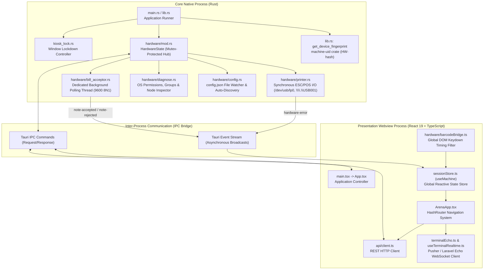
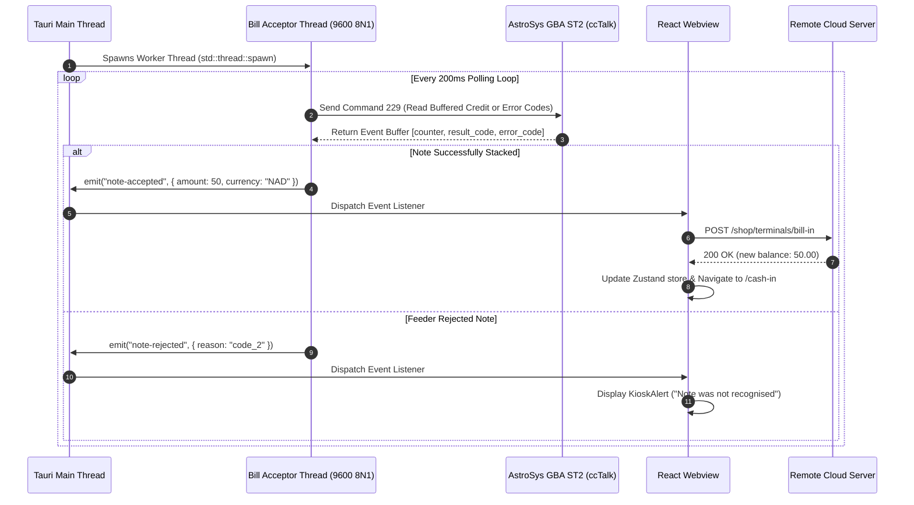

# Betwise Terminal — System Architecture

**Document Version:** 1.0.0  
**Scope:** Multi-Process Architecture, Tauri IPC, Concurrency, and System Security  
**Repository:** `Kiosk-tauri` (`betwise-terminal`)

---

## 1. High-Level Architectural Model

Betwise Terminal is constructed on **Tauri v2**, employing a strict two-tier decoupled process architecture:
1. **The Core Host Process (Native Rust Layer):** Manages native operating system windows, low-level hardware serial/USB drivers, hardware cryptographic fingerprint generation, and OS-level kiosk confinement.
2. **The Presentation Process (Webview React Layer):** Executes a single-page React 19 application running in the OS-provided webview (WebKitGTK on Linux, WebView2 on Windows). Handles UI states, routing, sound, user interactions, local game loops, and REST/WebSocket network communications.



---

## 2. Process Separation & Responsibilities

| Dimension | Native Rust Process (`src-tauri`) | Webview Process (`src`) |
| :--- | :--- | :--- |
| **Language & Toolchain** | Rust 2021 Edition (`cargo`, `rustc 1.77+`) | TypeScript 6, React 19, Vite 8 (`npm`) |
| **Operating System Permissions** | Direct OS syscalls, serial port I/O, raw USB file writes | Sandboxed browser environment (restricted by CSP) |
| **Hardware Access** | Opens `/dev/ttyUSB*`, `/dev/usb/lp*`, `COM*`, `\\.\USB*` | No direct device handles; listens to IPC events or keyboard events |
| **Window & Desktop Control** | Fullscreen, non-resizable, always-on-top, borderless | DOM rendering, layout styling, modal view presentation |
| **Authentication Authority** | Evaluates machine hardware UUID from OS subsystems | Transmits `device_fingerprint` to remote REST API |
| **State Lifespan** | Survives frontend soft reloads; holds persistent serial loops | Reset on page refresh; state stored in `localStorage` or Zustand |

---

## 3. Tauri IPC Command and Event Bridge

Communication across the process boundary is strictly managed through Tauri v2's type-safe IPC protocol.

### 3.1 Registered Native Commands (`tauri::generate_handler!`)

All commands are declared in [`src-tauri/src/lib.rs`](file:///home/sys-0743/My_projects_Murali/newfolder/Kiosk-tauri/src-tauri/src/lib.rs#L14-L26) and invoked from frontend modules:

| Command Name | Arguments | Return Type | Origin File | Primary Consumer | Purpose |
| :--- | :--- | :--- | :--- | :--- | :--- |
| `get_device_fingerprint` | *None* | `Result<String, String>` | [`lib.rs`](file:///home/sys-0743/My_projects_Murali/newfolder/Kiosk-tauri/src-tauri/src/lib.rs#L51-L72) | [`storage.ts`](file:///home/sys-0743/My_projects_Murali/newfolder/Kiosk-tauri/src/lib/storage.ts#L74-L88) | Computes unique hardware ID (`HW-<uuid>`) via `machine-uid`. |
| `get_operating_system` | *None* | `String` | [`lib.rs`](file:///home/sys-0743/My_projects_Murali/newfolder/Kiosk-tauri/src-tauri/src/lib.rs#L74-L87) | [`storage.ts`](file:///home/sys-0743/My_projects_Murali/newfolder/Kiosk-tauri/src/lib/storage.ts#L90-L100) | Returns runtime OS string (`Linux`, `Windows`, `macOS`, `Android`). |
| `hardware_start` | *None* | `Result<HardwareStatusDto, String>` | [`hardware/mod.rs`](file:///home/sys-0743/My_projects_Murali/newfolder/Kiosk-tauri/src-tauri/src/hardware/mod.rs#L81-L84) | [`ArenaApp.tsx`](file:///home/sys-0743/My_projects_Murali/newfolder/Kiosk-tauri/src/screens/ArenaApp.tsx#L120) | Re-reads `config.json` and connects serial bill acceptor + thermal printer. |
| `hardware_status` | *None* | `Result<HardwareStatusDto, String>` | [`hardware/mod.rs`](file:///home/sys-0743/My_projects_Murali/newfolder/Kiosk-tauri/src-tauri/src/hardware/mod.rs#L86-L89) | [`ArenaApp.tsx`](file:///home/sys-0743/My_projects_Murali/newfolder/Kiosk-tauri/src/screens/ArenaApp.tsx#L133) | Polled every 5 seconds to track printer connectivity. |
| `hardware_diagnose` | *None* | `Result<DiagnoseReport, String>` | [`hardware/mod.rs`](file:///home/sys-0743/My_projects_Murali/newfolder/Kiosk-tauri/src-tauri/src/hardware/mod.rs#L91-L96) | [`HardwareTestGate.tsx`](file:///home/sys-0743/My_projects_Murali/newfolder/Kiosk-tauri/src/components/HardwareTestGate.tsx#L68) | Inspects OS groups (`lp`, `dialout`), device nodes, and write capabilities. |
| `get_kiosk_hw_config` | *None* | `Result<KioskHwConfig, String>` | [`hardware/mod.rs`](file:///home/sys-0743/My_projects_Murali/newfolder/Kiosk-tauri/src-tauri/src/hardware/mod.rs#L106-L109) | [`ArenaApp.tsx`](file:///home/sys-0743/My_projects_Murali/newfolder/Kiosk-tauri/src/screens/ArenaApp.tsx#L103) | Returns parsed configuration parameters from `config.json`. |
| `set_shop_available_coins`| `amount: f64` | `()` | [`hardware/mod.rs`](file:///home/sys-0743/My_projects_Murali/newfolder/Kiosk-tauri/src-tauri/src/hardware/mod.rs#L111-L114) | [`ArenaApp.tsx`](file:///home/sys-0743/My_projects_Murali/newfolder/Kiosk-tauri/src/screens/ArenaApp.tsx#L160) | Stores maximum allowable credit limit in `SHOP_AVAILABLE_CENTS`. |
| `print_cashout_ticket` | `ticket: PrintTicketInput` | `Result<bool, String>` | [`hardware/mod.rs`](file:///home/sys-0743/My_projects_Murali/newfolder/Kiosk-tauri/src-tauri/src/hardware/mod.rs#L125-L132) | [`ArenaApp.tsx`](file:///home/sys-0743/My_projects_Murali/newfolder/Kiosk-tauri/src/screens/ArenaApp.tsx#L633) | Writes ESC/POS receipt commands and Code 128 barcode directly to printer device. |
| `print_test_ticket` | *None* | `Result<bool, String>` | [`hardware/mod.rs`](file:///home/sys-0743/My_projects_Murali/newfolder/Kiosk-tauri/src-tauri/src/hardware/mod.rs#L98-L104) | [`HardwareTestGate.tsx`](file:///home/sys-0743/My_projects_Murali/newfolder/Kiosk-tauri/src/components/HardwareTestGate.tsx#L102) | Prints diagnostic test slip verifying cutter and font rendering. |
| `enter_kiosk_mode` | *None* | `Result<bool, String>` | [`kiosk_lock.rs`](file:///home/sys-0743/My_projects_Murali/newfolder/Kiosk-tauri/src-tauri/src/kiosk_lock.rs#L19-L23) | [`StaffExitGate.tsx`](file:///home/sys-0743/My_projects_Murali/newfolder/Kiosk-tauri/src/components/StaffExitGate.tsx#L18) | Restores window lockdown (fullscreen, always-on-top, non-resizable). |
| `exit_kiosk_mode` | `password: String` | `Result<bool, String>` | [`kiosk_lock.rs`](file:///home/sys-0743/My_projects_Murali/newfolder/Kiosk-tauri/src-tauri/src/kiosk_lock.rs#L26-L59) | [`StaffExitGate.tsx`](file:///home/sys-0743/My_projects_Murali/newfolder/Kiosk-tauri/src/components/StaffExitGate.tsx#L40) | Validates `AdminPassword` from `config.json`; exits lockdown to 1280x800. |

### 3.2 Asynchronous Event Streams

The Rust hardware backend emits real-time events to the webview window using `app.emit(...)`:

1. **`note-accepted`** (`{ amount: f64, currency: String }`):
   - Fired when the GBA ST2 bill acceptor completes stacking a verified banknote.
   - Handled in [`ArenaApp.tsx`](file:///home/sys-0743/My_projects_Murali/newfolder/Kiosk-tauri/src/screens/ArenaApp.tsx#L245) by calling `acceptCash(amount)`, which initiates `POST /shop/terminals/bill-in`.
2. **`note-rejected`** (`{ reason: String }`):
   - Fired when a banknote is rejected by the validator feeder or inhibited by shop coin limits (`shop_balance_too_low`, `code_2`, `code_3`, `code_4`, `code_5`).
   - Displays a contextual modal dialog explaining why the note was rejected.
3. **`hardware-error`** (`{ device: String, error: String }`):
   - Fired when device communication fails (e.g. disconnected USB cable or permission denied).
   - Ignored on lab development machines (missing `/dev/ttyUSB0` or `COM3`); raises high-priority alerts on physical cabinets.

---

## 4. Hardware Concurrency & Threading Model

The native hardware layer maintains continuous polling loops without blocking the main Tauri event loop:



### 4.1 Mutex Protection (`HardwareState`)
The application-wide state is managed in [`HardwareState`](file:///home/sys-0743/My_projects_Murali/newfolder/Kiosk-tauri/src-tauri/src/hardware/mod.rs#L13-L17):
- `config: Mutex<KioskHwConfig>`: Guards configuration reloading.
- `bill: Mutex<BillAcceptorHandle>`: Controls the lifecycle of the serial background thread and communication ports.
- `printer: Mutex<PrinterHandle>`: Synchronizes write operations to the receipt printer device file to prevent interleaved ESC/POS byte streams.

### 4.2 Atomic Coin Limits (`SHOP_AVAILABLE_CENTS`)
To prevent the bill acceptor from taking cash when the betting shop's portal coin float is depleted, the backend provides `available_coins` in heartbeat and session responses. This value is stored in Rust using `static SHOP_AVAILABLE_CENTS: AtomicU64`. The background thread checks this atomic integer *before* commanding the validator to stack the note. If the note value exceeds the available shop float, the note is rejected with reason `shop_balance_too_low`.

---

## 5. Security Architecture & Kiosk Lockdown

### 5.1 Content Security Policy (CSP)
The webview window enforces a restrictive CSP defined in [`src-tauri/tauri.conf.json`](file:///home/sys-0743/My_projects_Murali/newfolder/Kiosk-tauri/src-tauri/tauri.conf.json#L31-L34):
```text
default-src 'self' 'unsafe-inline' 'unsafe-eval' asset: http://asset.localhost https: http:;
img-src 'self' https: http: data: blob: asset: http://asset.localhost;
connect-src 'self' https: http: ws: wss: ipc: http://ipc.localhost https://tauri.localhost http://tauri.localhost;
style-src 'self' 'unsafe-inline' https: http:;
font-src 'self' https: http: data:;
script-src 'self' 'unsafe-inline' 'unsafe-eval' https: http:;
```
*Key Safeguard:* External network requests are restricted to HTTPS/WSS endpoints. Webview assets and Tauri IPC channels are explicitly whitelisted.

### 5.2 Anti-Clone Hardware Fingerprinting
To prevent unauthorized distribution or duplication of the kiosk software on unregistered machines:
1. The machine ID is registered once during initialization using a setup token.
2. The Rust backend reads hardware parameters via `machine_uid::get()`:
   - On Linux, this reads `/etc/machine-id` or `/var/lib/dbus/machine-id`.
   - On Windows, this reads the `MachineGuid` registry key under `HKEY_LOCAL_MACHINE\SOFTWARE\Microsoft\Cryptography`.
3. Every REST request to the server includes `device_fingerprint=HW-<hash>`.
4. If a cloned copy is executed on different hardware, the server detects a mismatch and returns HTTP 403/422 with error code `HARDWARE_MISMATCH`. The client immediately terminates gameplay and displays [`UnauthorizedScreen`](file:///home/sys-0743/My_projects_Murali/newfolder/Kiosk-tauri/src/screens/UnauthorizedScreen.tsx).

### 5.3 Lockdown Confinement Policy
Physical kiosk terminals are secured against customer tampering:
- **Window Flags:** Fullscreen mode is forced; window decorations, minimize buttons, close buttons, and resizability are permanently disabled.
- **Always On Top:** `set_always_on_top(true)` prevents third-party OS popups or background windows from stealing focus.
- **Frontend Keyboard Trap:** When `balance <= 0`, [`handleKioskKeyboardPolicy`](file:///home/sys-0743/My_projects_Murali/newfolder/Kiosk-tauri/src/screens/ArenaApp.tsx#L317-L364) prevents standard browser keys (`Tab`, `Space`, `Backspace`, `Escape`, `F1-F12`, `Arrow Keys`, `Home`, `End`, `PageUp`, `PageDown`) from scrolling or selecting DOM nodes.

---

## 6. Runtime Configuration & Port Resolution

The terminal loads configuration from [`config.json`](file:///home/sys-0743/My_projects_Murali/newfolder/Kiosk-tauri/config.json) located in the application working directory.

### 6.1 Configuration Schema
```json
{
  "API_URL": "http://127.0.0.1:8000/api",
  "Terminal_ID": "KIOSK-001",
  "Printer_Name": "EPSON TM-T88V",
  "Printer_Device": "auto",
  "BillAcceptor_Port": "auto",
  "CoinAcceptor_Port": "",
  "AdminPassword": "admin123",
  "Currency": "NAD",
  "CurrencySymbol": "N$",
  "SessionTimeoutSeconds": 120,
  "DepositRetryIntervalMs": 5000,
  "DepositMaxRetries": 12,
  "KioskLockdown": false
}
```

### 6.2 "auto" Device Discovery Rules
When `BillAcceptor_Port` or `Printer_Device` is set to `"auto"`, [`src-tauri/src/hardware/config.rs`](file:///home/sys-0743/My_projects_Murali/newfolder/Kiosk-tauri/src-tauri/src/hardware/config.rs) applies dynamic OS-specific discovery:
- **Bill Acceptor (`auto`):**
  - **Linux:** Probes `/dev/ttyUSB0`, `/dev/ttyUSB1`, `/dev/ttyACM0`. Checks read/write accessibility.
  - **Windows:** Checks `COM3`, `COM1`, `COM2`, `COM4`, `COM5`.
- **Printer Device (`auto`):**
  - **Linux:** Probes `/dev/usb/lp0`, `/dev/usb/lp1`, `/dev/usb/lp2`.
  - **Windows:** Probes `\\.\USB001`, `\\.\USB002`, `\\.\LPT1`.
