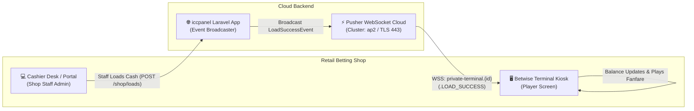
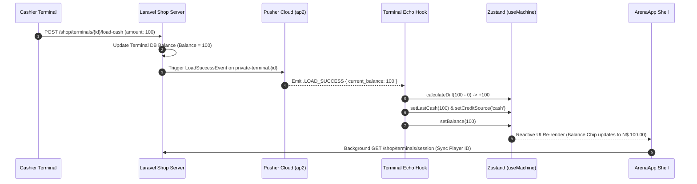

# Betwise Terminal — WebSocket & Real-Time Event Pipeline

**Document Version:** 1.0.0  
**Scope:** Pusher JS, Laravel Echo, Private Channels, Channel Authorization, and Real-Time Event Listeners  
**Repository:** `Kiosk-tauri` (`betwise-terminal`)

---

## 1. Real-Time Architecture Overview

Betwise Terminal uses **Pusher JS (`pusher-js` v8.6.0)** alongside **Laravel Echo (`laravel-echo` v2.5.0)** to maintain persistent bidirectional communication with the betting shop backend.

This real-time event pipeline enables:
1. **Remote Cashier Loading:** When a shop cashier loads coins into this terminal from the web cashier portal, the kiosk UI updates instantly without requiring manual page reloads.
2. **Synchronized Player Balance:** Live chip updates during game sessions are broadcast directly over individual player channels.
3. **Cash-Out Decisioning:** Cash-out approvals and rejections are pushed directly to the kiosk terminal.



---

## 2. Configuration & Initialization

Real-time communication is configured in [`src/config/env.ts`](file:///home/sys-0743/My_projects_Murali/newfolder/Kiosk-tauri/src/config/env.ts#L47-L53):

| Environment Variable | Description | Default Value | Fallback Behavior |
| :--- | :--- | :--- | :--- |
| `VITE_PUSHER_APP_KEY` | Public application key for Pusher | `""` (Set in `.env`) | If empty, `isTerminalRealtimeEnabled()` returns `false`, disabling Echo. |
| `VITE_PUSHER_APP_CLUSTER`| Geographical cluster for Pusher edge | `"ap2"` | Defaults to Asia-Pacific 2 (`ap2`). |

### Connection Singleton (`src/lib/terminalEcho.ts`)
To prevent duplicate socket connections and memory leaks during React hot reloads, the connection is maintained as a singleton:
```typescript
let echo: TerminalEcho | null = null
let echoKey: string | null = null
```
The unique connection key is composed of `${apiBase}|${machineId}|${hardwareId}`. If the active terminal machine ID or hardware ID changes, the prior connection is disconnected before instantiating the new socket.

---

## 3. Custom Terminal Channel Authorization

Standard Laravel Echo channels use Sanctum session cookies or Bearer tokens. Because Betwise Terminal uses hardware-level authentication, [`terminalEcho.ts`](file:///home/sys-0743/My_projects_Murali/newfolder/Kiosk-tauri/src/lib/terminalEcho.ts#L50-L77) defines a **Custom Hardware Authorizer**:

```typescript
authorizer: (channel) => ({
  authorize: (socketId: string, callback: ChannelAuthorizationCallback) => {
    void fetch(`${apiBase}/broadcasting/auth/terminal`, {
      method: 'POST',
      headers: {
        'Content-Type': 'application/json',
        Accept: 'application/json',
      },
      body: JSON.stringify({
        socket_id: socketId,
        channel_name: channel.name,
        machine_id: input.machineId,
        device_fingerprint: input.hardwareId,
      }),
    })
      .then(async (response) => {
        if (!response.ok) {
          callback(new Error(await response.text()), null)
          return
        }
        const data = (await response.json()) as { auth: string }
        callback(null, data)
      })
      .catch((error: unknown) => {
        callback(error instanceof Error ? error : new Error('Terminal channel auth failed'), null)
      })
  },
})
```

- **Endpoint:** `POST /api/v1/{portal_slug}/shop/broadcasting/auth/terminal`
- **Payload:** `{ socket_id, channel_name, machine_id, device_fingerprint }`
- **Response:** `{ "auth": "aada91de...:d92b..." }`

---

## 4. Channels and Event Handlers

Real-time events are orchestrated by the [`useTerminalRealtime`](file:///home/sys-0743/My_projects_Murali/newfolder/Kiosk-tauri/src/lib/useTerminalRealtime.ts) hook inside [`ArenaApp.tsx`](file:///home/sys-0743/My_projects_Murali/newfolder/Kiosk-tauri/src/screens/ArenaApp.tsx#L180-L213).

### 4.1 Terminal Channel: `private-terminal.{machineDbId}`

| Event Name | Payload Schema | Action Performed |
| :--- | :--- | :--- |
| **`.LOAD_SUCCESS`** | `{ current_balance: number, amount?: number }` | - Reads updated balance.<br>- Calculates difference (`next - currentBalance`).<br>- If positive, sets `creditSource = 'cash'` and updates `lastCashAmount`.<br>- Calls `setBalance(next)`.<br>- Triggers background `fetchSession()` to ensure session state consistency. |
| **`.CASHOUT_APPROVED`** | `{ current_balance: number }` | - Updates active kiosk balance (`setBalance`).<br>- Confirms completion of external cashier redemption. |
| **`.CASHOUT_REJECTED`** | `{ reason?: string }` | - Handled by application error logger. |

### 4.2 Player Channel: `player.{playerId}`
Subscribed whenever a valid `player_id` is linked to the active kiosk session (e.g. during an Aviator or Spribe session).

| Event Name | Payload Schema | Action Performed |
| :--- | :--- | :--- |
| **`.PlayerBalanceUpdated`**<br>*(or unprefixed `PlayerBalanceUpdated`)* | `{ chips: number }` | - Parses `chips` float value.<br>- Updates `useMachine.getState().setBalance(chips)`.<br>- Synchronizes screen balance with ongoing provider wagers. |

---

## 5. Event Flow Sequence: Remote Cashier Loading



---

## 6. Resilience & Fallback Polling

WebSockets provide low-latency updates, but kiosk terminals operate in retail environments with variable connectivity. The system implements a multi-tier fallback mechanism:

1. **Automatic HTTP Session Polling:**
   - In addition to real-time events, [`ArenaApp.tsx`](file:///home/sys-0743/My_projects_Murali/newfolder/Kiosk-tauri/src/screens/ArenaApp.tsx#L215-L230) dispatches a heartbeat to `POST /terminals/heartbeat` every 60 seconds.
   - Any financial transaction (such as `billIn`, `ticketIn`, or `placeBet`) immediately performs a follow-up `fetchSession()` call to re-verify the authoritative balance directly from the database.
2. **Pusher Auto-Reconnect:**
   - Pusher JS automatically handles socket drops, exponential backoff, and reconnection attempts.
   - When the socket reconnects (`connection.bind('connected')`), the terminal re-authorizes private channels automatically.
3. **Graceful Degradation:**
   - If Pusher credentials (`VITE_PUSHER_APP_KEY`) are missing, the terminal operates normally using standard REST endpoints without crashing.
